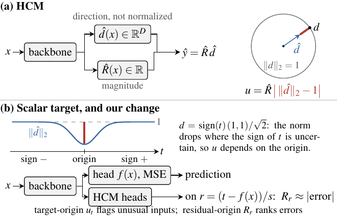
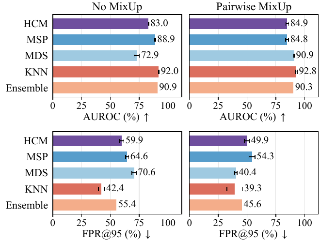
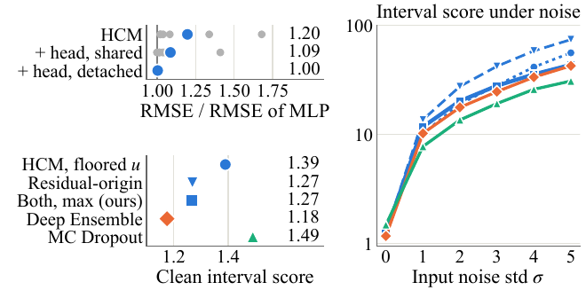

# AI6103 Deep Learning & Applications — Group Project: Hyperspherical Confidence Mapping, Fair Evaluation and Improvements

Course group project for **AI6103 (NTU, Fall 2026)**. We reproduce **Hyperspherical Confidence
Mapping (HCM)** (Choi et al., ICLR 2026), a one-forward-pass uncertainty method that predicts a
magnitude and a direction for the target and reads uncertainty from how far the predicted
direction is from unit length. We evaluate it under matched training and answer four questions
the paper leaves open:

- **Q1** Does HCM keep classification accuracy, and how does it compare with standard OOD detectors trained the same way?
- **Q2** Do the score formulas in the paper and in the official code agree?
- **Q3** What does the score measure for a scalar regression target?
- **Q4** How sensitive is HCM to its training settings (learning rate, warm-up, norm penalty)?

For regression we also propose two improvements: split conformal calibration with a floored
width, and a separate prediction head with HCM applied to the residual.

The final report (AAAI-24 format, 7 pages) is in [`report/HCM_final_report.pdf`](report/HCM_final_report.pdf).

**Video presentation:** <https://youtu.be/h21pBx1kzgk> (animations made with [Manim](https://github.com/3b1b/manim))

[](https://youtu.be/h21pBx1kzgk)

**Team:** Ji Qiankun, Shi Haochen, Wang Zhongda, Wei Yutao, Zheng Haoyang.



## Results

### CIFAR-10 out-of-distribution detection (report Section 4)

ResNet-18, six OOD sets (CIFAR-100, Tiny-ImageNet, MNIST, SVHN, DTD, Places365), mean ± std over
five seeds (three for Dirichlet MixUp), last-epoch models.

| Configuration | Test acc. (%) | HCM OOD AUROC (%) | FPR@95 (%) |
|---|---|---|---|
| CE | 94.07 ± 0.08 | – | – |
| HCM | 94.23 ± 0.18 | 83.04 ± 0.29 (paper: 85.04) | 59.94 ± 1.76 |
| CE + pairwise MixUp | 94.85 ± 0.15 | – | – |
| **HCM + pairwise MixUp (decomposed targets)** | 94.81 ± 0.13 | **84.90 ± 1.27** (paper: 89.44) | 49.88 ± 2.17 |
| HCM + pairwise MixUp (soft targets) | 94.65 ± 0.14 | 81.72 ± 2.63 | 56.71 ± 2.65 |
| HCM + Dirichlet MixUp (k = 20) | 85.50 ± 0.40 | 77.44 ± 1.16 | 80.14 ± 2.40 |
| CE + Dirichlet MixUp (k = 20) | 84.97 ± 0.44 | – | – |

FPR@95 follows the OpenOOD convention (ID samples are the positives).

**Matched comparison with standard detectors** (same backbone and training, average AUROC %):

| Detector | No MixUp | Pairwise MixUp |
|---|---|---|
| KNN | **92.01 ± 0.36** | **92.75 ± 0.85** |
| Ensemble (5 seeds) | 90.90 | 90.33 |
| MSP | 88.93 ± 0.31 | 84.82 ± 1.29 |
| MDS | 72.90 ± 2.38 | 90.87 ± 0.23 |
| HCM | 83.04 ± 0.29 | 84.90 ± 1.27 |



### UCI scalar regression (report Section 5)

Six UCI datasets (wine, concrete, energy, kin8nm, power, yacht), small MLP as in the paper.

- For a scalar target the HCM score measures how uncertain the **sign** of the target is, so it
  depends on the origin of the target space and does not rank prediction errors.
- Split conformal calibration with a floored width brings clean-data coverage from 84.5 % to
  within about one point of the nominal 90 %.
- A separate prediction head with HCM on the residual brings the test error within 0.5 % of a
  plain network and raises the rank correlation between score and error from 0.15 to 0.24.



**Key takeaways**

- HCM keeps the accuracy of cross-entropy training and needs only one forward pass.
- Our reproduced AUROC is 2.0 to 4.5 points below the paper's, and under matched training HCM is
  8 to 9 points below KNN.
- How a MixUp label is split into magnitude and direction matters: decomposed targets beat soft
  targets by 3.2 AUROC points.
- The five score formulas in the paper and its code differ only when the predicted magnitude varies.
- HCM is a cheap detector of unusual inputs, not a reliable error estimator; in regression it needs
  conformal calibration and the residual origin to be useful.

## Repository structure

```text
├── cifar10_ood/            # CIFAR-10 OOD detection (report Section 4)
│   ├── train.py            # CE / HCM training, MixUp variants, resume
│   ├── export_outputs.py   # logits, features, d and R for train, test and six OOD sets
│   ├── eval_hcm_ood.py     # HCM OOD metrics for the five score formulas
│   ├── hcm/                # models, losses, MixUp, data, scores, metrics
│   ├── scripts/            # reproduce_expA.sh, run_queue.sh, sensitivity runs, SLURM job
│   ├── results/            # reference results of our runs
│   ├── README.md           # setup and exact commands
│   └── SENSITIVITY.md      # training-sensitivity runs (Section 4.5)
├── uci_regression/         # UCI regression study and the two improvements (Section 5)
│   ├── train.py, models.py, data.py, run_grid.py, analyze_*.py, make_figures.py
│   ├── data_cache/         # the datasets, already downloaded
│   ├── figures/, tables/   # outputs of make_figures.py
│   └── README.md
├── report_figures/         # scripts for Figures 1–4 of the report
├── report/                 # LaTeX source (AAAI-24 style) + compiled PDF
└── docs/figures/           # figures used in this README
```

## Getting started

**CIFAR-10 part** (GPU; one run takes about 22 minutes on an A40):

```bash
cd cifar10_ood
pip install -r requirements.txt
bash scripts/smoke_test.sh          # about 5 minutes on random tensors
bash scripts/reproduce_expA.sh      # all Section 4.2 runs + evaluation (about 11.5 GPU-hours)
```

Data download commands and the full list of runs are in [`cifar10_ood/README.md`](cifar10_ood/README.md).

**UCI part** (CPU only; one run takes 1 to 20 seconds):

```bash
cd uci_regression
pip install -r requirements.txt
python train.py --exp demo --dataset yacht --method hcm --target_mode standardize --lr 1e-3
```

The commands for every table and figure are in [`uci_regression/README.md`](uci_regression/README.md).

**Hardware note:** the CIFAR-10 runs were done on NTU's CCDS TC2 SLURM cluster (single NVIDIA A40).
`cifar10_ood/scripts/slurm_job.sbatch` is a generic SLURM template.

## Build the report

```bash
cd report
pdflatex main.tex && bibtex main && pdflatex main.tex && pdflatex main.tex
```

## Note

Not included: the datasets used by the CIFAR-10 part, the CIFAR-10 checkpoints and exported
outputs (about 8 GB), the saved UCI runs (about 480 MB; regenerated by the commands in
`uci_regression/README.md`), and the baseline scoring scripts for MSP, MDS, KNN and the ensemble.

Model and loss code for the CIFAR-10 part is a rewrite of the official HCM implementation
(`github.com/Abandoned-Puppy/HCM`).
