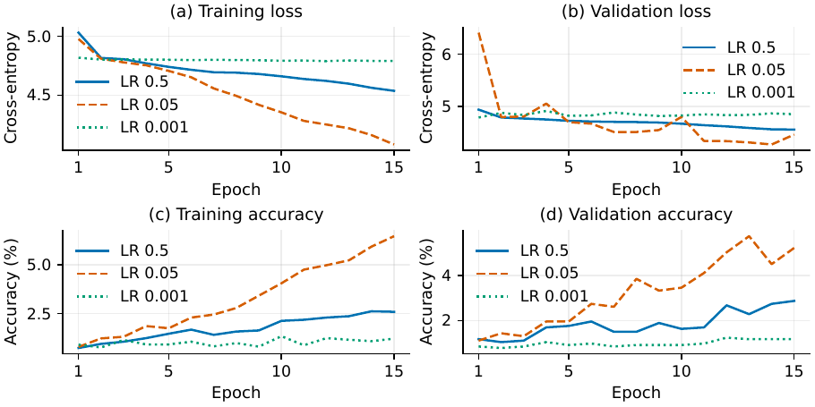
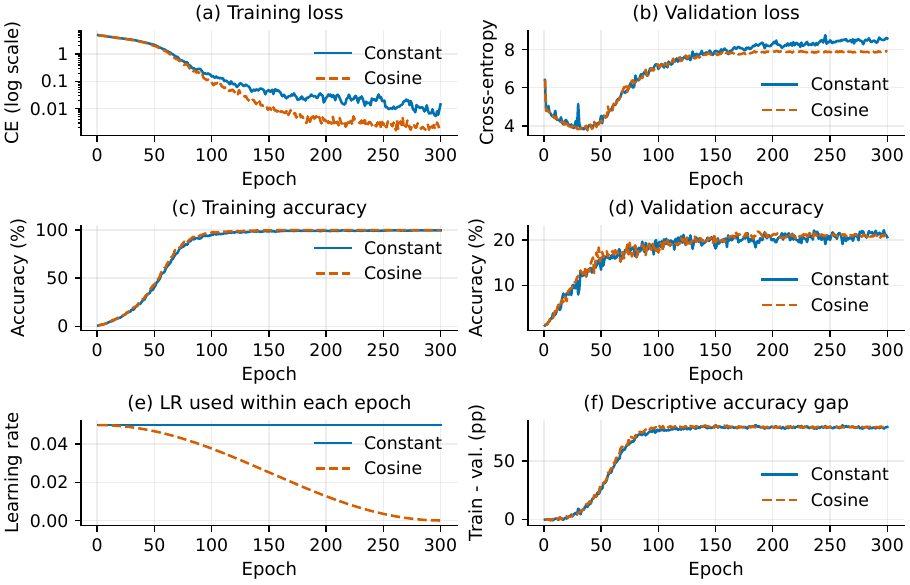
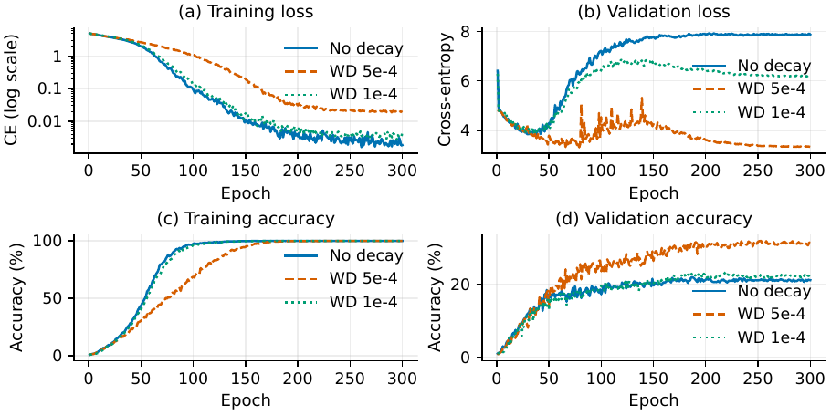
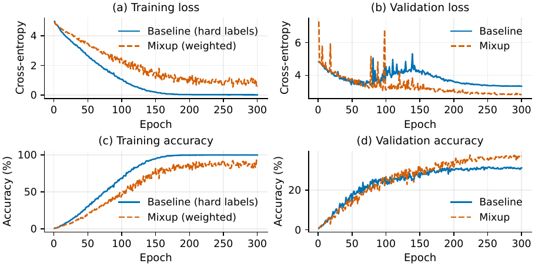

# AI6103 Deep Learning & Applications — Training EfficientNetV2-S from Scratch

Course assignment for **AI6103 (NTU, Fall 2026)**. A 120-class dog-breed classifier is trained from scratch with
**EfficientNetV2-S** + SGD (momentum 0.9), and the effect of four training choices is studied step by step:

1. **Learning rate** (Section 3) — 0.5 / 0.05 / 0.001, 15 epochs each
2. **LR schedule** (Section 4) — constant vs. cosine annealing, 300 epochs
3. **Weight decay** (Section 5) — 5e-4 vs. 1e-4 (with cosine), 300 epochs
4. **Mixup** (Section 6) — α = 0.2 on top of the best Section 5 setting, 300 epochs

The final report (AAAI format, 6 pages) is in [`report/AI6103_report.pdf`](report/AI6103_report.pdf).

**Report grade: 28 / 30**

## Results

All runs: batch 128, 100×100 input, random crop (padding 12) + horizontal flip, seed 6103, no pre-trained weights.

| Experiment | LR | Schedule | Weight decay | Mixup | Epochs | Final train loss | Final val loss | Final val acc |
|---|---|---|---|---|---|---|---|---|
| sec3_lr0.5 | 0.5 | constant | 0 | – | 15 | 4.537 | 4.558 | 2.87% |
| **sec3_lr0.05** | 0.05 | constant | 0 | – | 15 | **4.081** | 4.462 | 5.22% |
| sec3_lr0.001 | 0.001 | constant | 0 | – | 15 | 4.791 | 4.851 | 1.17% |
| sec4_constant | 0.05 | constant | 0 | – | 300 | 0.014 | 8.575 | 20.68% |
| sec4_cosine | 0.05 | cosine | 0 | – | 300 | 0.002 | 7.874 | 21.07% |
| **sec5_wd5e-4** | 0.05 | cosine | 5e-4 | – | 300 | 0.019 | **3.332** | 31.25% |
| sec5_wd1e-4 | 0.05 | cosine | 1e-4 | – | 300 | 0.004 | 6.193 | 22.11% |
| **sec6_mixup** | 0.05 | cosine | 5e-4 | α=0.2 | 300 | 0.605* | **2.833** | **37.38%** |

\* Mixup training loss is computed on mixed (soft) labels, so it is not directly comparable to the others.

**Held-out test set** (final model = `sec6_mixup`, epoch-300 checkpoint, evaluated once):
**accuracy 38.07 %** (584 / 1,534), cross-entropy 2.771.

Full metrics: [`results/verified_metrics.json`](results/verified_metrics.json) ·
test record: [`results/final_test_result.json`](results/final_test_result.json)

| LR sweep | Schedule | Weight decay | Mixup |
|---|---|---|---|
|  |  |  |  |

**Key takeaways**

- LR 0.05 gave the lowest training loss after 15 epochs; 0.5 was unstable and 0.001 too slow.
- Without regularisation, both 300-epoch runs overfit badly (train acc ≈ 100 %, val loss rising to ~8); cosine helps only slightly.
- Weight decay 5e-4 is the biggest single improvement (val acc 21 % → 31 %).
- Mixup further reduces overfitting and gives the best validation and test accuracy.

## Repository structure

```text
├── scripts/                  # experiment code (package: `scripts`)
│   ├── run_all.py            # CLI entry point
│   ├── config.py             # all experiment configs (Sections 3–6)
│   ├── dataset.py            # data loading, augmentation, train-only RGB statistics
│   ├── train.py              # model / optimiser / scheduler / Mixup / checkpointing
│   ├── protocol.py           # model selection, freeze, one-shot final test
│   ├── plots.py              # figures (learning curves, Beta(0.2,0.2) PDF)
│   ├── gpu_guard.py, tc2_guard.py   # GPU / SLURM safety checks
│   └── fill_latex.py, compile_report.py
├── tests/                    # pytest unit tests
├── report/                   # LaTeX source (AAAI-24 style) + compiled PDF
├── results/                  # final metrics, Section 6 learning curves, test result
├── docs/                     # experiment protocol and README figures
├── notebooks/
│   └── AI6103_HW_Colab.ipynb # Colab entry point (calls the same CLI)
└── requirements.txt
```

## Getting started

```bash
# 1. Install PyTorch (with CUDA if available) first, see https://pytorch.org
pip install torch torchvision
pip install -r requirements.txt

# 2. Put the dataset under data/ (not included in this repo)
data/
  train/images/<id>.jpg   train_labels.csv   # id,breed  (7,155 images)
  val/images/<id>.jpg     val_labels.csv     # 1,533 images
  test/images/<id>.jpg    test_labels.csv    # 1,534 images

# 3. Run
python scripts/run_all.py validate            # check dataset
python scripts/run_all.py prepare-stats       # RGB mean/std from training images only
python scripts/run_all.py smoke-test          # tiny sanity run
python scripts/run_all.py train --section 3   # then select --section 3, train --section 4/5/6 ...
python scripts/run_all.py plot
python -m pytest tests -q
```

Runs save a checkpoint every epoch and can be continued with `--resume`. The test set is never used during
training or model selection; it is evaluated once via `freeze` + `evaluate-final`.
See [`docs/EXPERIMENT_PROTOCOL.md`](docs/EXPERIMENT_PROTOCOL.md) for the full protocol and selection rules.

**Google Colab:** upload the whole repository to Google Drive, open
[`notebooks/AI6103_HW_Colab.ipynb`](notebooks/AI6103_HW_Colab.ipynb), and set `PROJECT` to the repository folder.
With the default settings it only prepares the data; training and the final test must be switched on explicitly.

**Hardware note:** the official runs were done on NTU's TC2 SLURM cluster (single NVIDIA A40/L40S,
`AI6103_PROFILE=tc2`). For a normal local machine leave `AI6103_PROFILE` unset.

## Build the report

```bash
cd report
pdflatex main.tex && bibtex main && pdflatex main.tex && pdflatex main.tex
```

## Note

The dataset, model checkpoints and the original assignment handout are not included.
