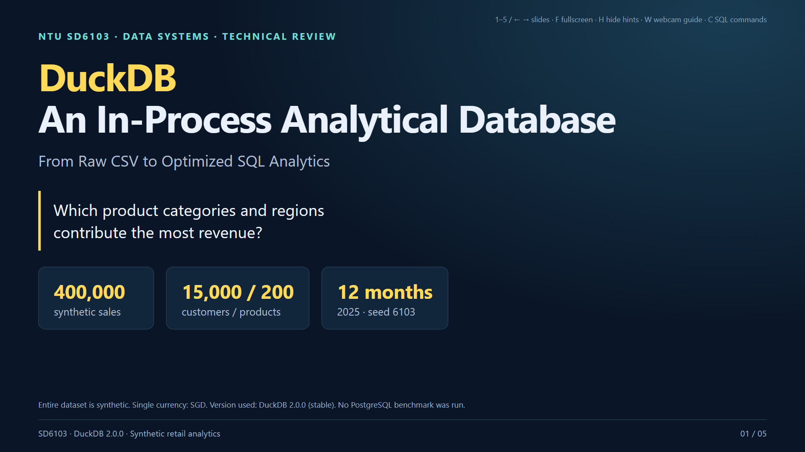
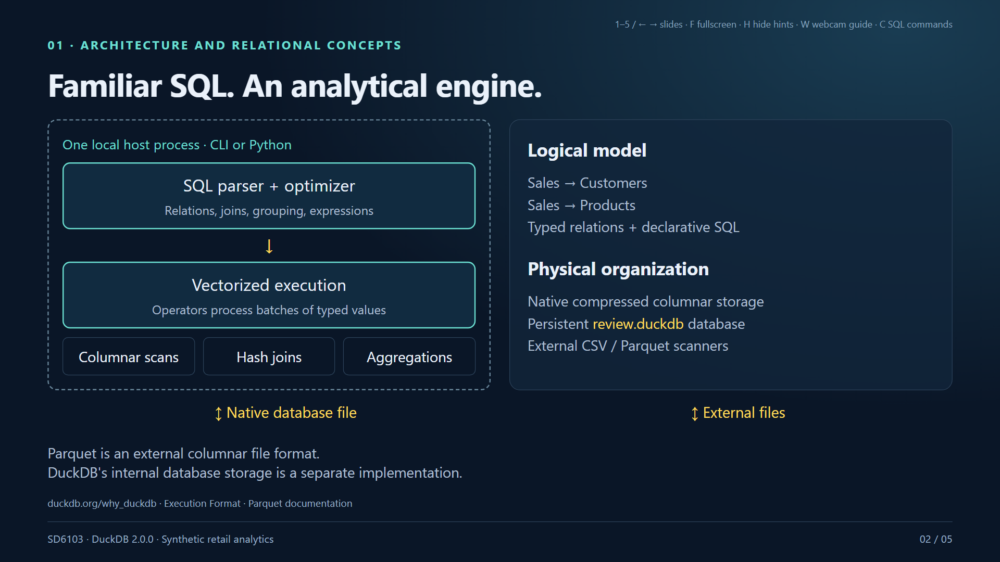
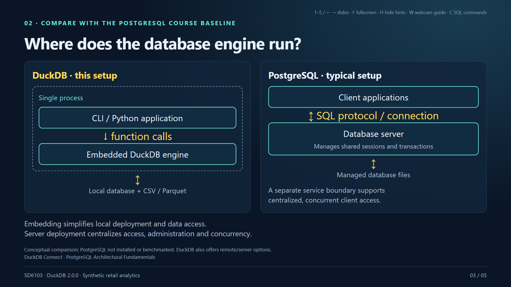
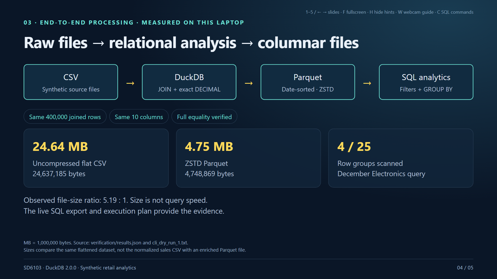
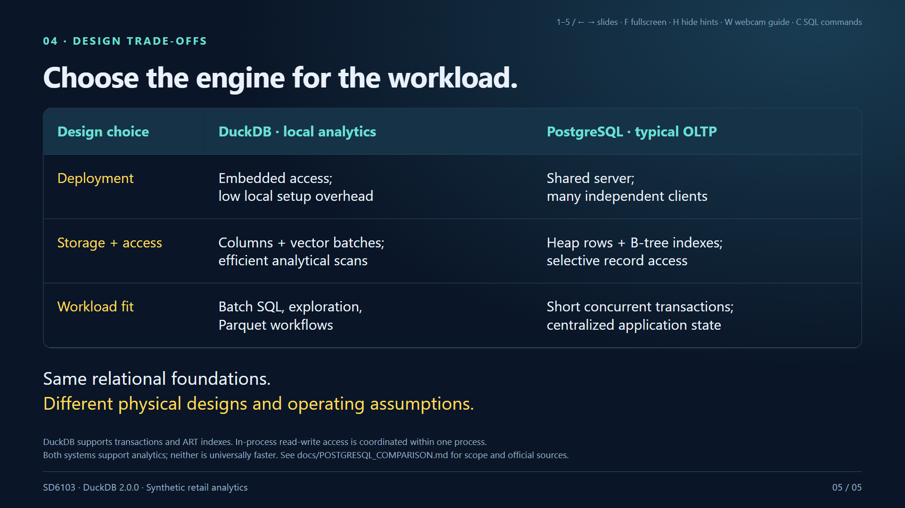

# DuckDB: An In-Process Analytical Database

**From raw CSV to optimized SQL analytics** — individual Technical Review for NTU **SD6103 Data Systems** (AY26/27 Semester 1).

The review sets up DuckDB 2.0.0, runs a small end-to-end analytics workflow on synthetic retail data, and relates what DuckDB does to the relational concepts of the course, using PostgreSQL as the baseline.

> **Business question:** Which product categories and regions contribute the most revenue, and how can DuckDB analyze the underlying data efficiently?

## Review summary

| Course concept | DuckDB (this setup) | PostgreSQL (typical deployment) |
|---|---|---|
| Data model and query language | Relational tables, keys, joins, declarative SQL | Same relational foundations |
| Deployment | **In-process**: the engine runs inside the CLI / Python process and opens one local database file | **Client–server**: a shared server process manages sessions for many clients |
| Storage | **Columnar**, compressed; external Parquet/CSV can be queried directly | **Row-oriented** heap pages |
| Query execution | **Vectorized**: operators process batches of values | General-purpose executor, tuple-at-a-time style |
| Access paths | Projection & filter pushdown, row-group **min/max pruning**; ART indexes available | B-tree (and other) indexes for selective lookups |
| Workload fit | Local exploration, batch analytics, Parquet workflows | Many concurrent short transactions, centralized application state |

Both systems support transactions and indexes; neither is universally faster. No PostgreSQL benchmark was run — the comparison is a scoped design argument. Full analysis: [`docs/TECHNICAL_REVIEW.md`](docs/TECHNICAL_REVIEW.md) and [`docs/POSTGRESQL_COMPARISON.md`](docs/POSTGRESQL_COMPARISON.md).

## Key measured results

All data are **synthetic** (Python `random.Random(6103)`), single currency (synthetic SGD).

| Observation | Result |
|---|---:|
| Sales / customers / products | 400,000 / 15,000 / 200 |
| Total net revenue (exact `DECIMAL`) | 137,462,571.20 |
| Top region / category | APAC / Electronics — 45,556 sales, 35,178,394.19 |
| Same 400k joined rows as flat CSV | 24,637,185 bytes |
| … as date-sorted ZSTD Parquet | 4,748,869 bytes (≈ 5.19 : 1 file size) |
| December Electronics query: row groups scanned | **4 of 25** |
| Rows emitted by the filtered scan / grouped output | 14,594 / 4 |

Evidence: [`verification/test_report.md`](verification/test_report.md) (39/39 automated checks PASS), [`verification/demo_results.txt`](verification/demo_results.txt), [`verification/05_analyze_plan.txt`](verification/05_analyze_plan.txt).

## Slides

| | |
|---|---|
|  |  |
|  |  |
|  | |

The slides are a single offline HTML file: [`presentation/index.html`](presentation/index.html).

## Quick start (Windows, PowerShell)

Requirements: Windows x64, Python ≥ 3.11 (tested 3.12), internet access for the first setup.

```powershell
git clone <this-repo-url>
cd SD6103-DuckDB-Technical-Review
powershell -NoProfile -ExecutionPolicy Bypass -File .\setup.ps1      # venv, pinned DuckDB 2.0.0, data, database, checks
powershell -NoProfile -ExecutionPolicy Bypass -File .\start_demo.ps1 # opens slides + DuckDB CLI
```

`setup.ps1` creates a project-only `.venv`, downloads the official DuckDB 2.0.0 CLI (SHA-256 checked) and Python wheel into `tools/`, regenerates the deterministic dataset, builds `database/review.duckdb`, runs `verify.ps1` and resets the demo. Use `-PythonExe C:\path\to\python.exe` if Python is not on `PATH`.

At the `DuckDB>` prompt run the five steps in order:

| Command | What it shows |
|---|---|
| `.read sql/01_intro.sql` | Version and database; `read_csv` counts the raw CSV directly (no import) |
| `.read sql/02_csv_analytics.sql` | Temporary 3-table JOIN view; `GROUP BY` region/category with exact decimals |
| `.read sql/03_parquet.sql` | `COPY` to date-sorted ZSTD Parquet; query the Parquet file directly |
| `.read sql/04_explain.sql` | `EXPLAIN`: filters and projections pushed into the Parquet scan |
| `.read sql/05_analyze.sql` | `EXPLAIN ANALYZE`: actual counts, `Row Groups Scanned: 4 / 25` |

Exit with `.quit`. Re-run the checks with `verify.ps1`; `reset_demo.ps1` removes only the live Parquet export.

## Repository layout

```text
setup.ps1 / verify.ps1 / reset_demo.ps1 / start_demo.ps1   entry points
scripts/        data generator, database build, validation, Python SQL fallback
sql/            00_initialize (setup only), 01–05 demo steps, 06 optional JOIN plan
presentation/   offline HTML slides
data/           dataset_manifest.json (seed, hashes, oracle totals); CSV/Parquet are generated
docs/           technical review, PostgreSQL comparison, sources, troubleshooting, slide images
verification/   recorded test report, results and real execution plans
```

## Notes and limitations

- Dataset is synthetic and laptop-scale; results illustrate system behavior, not real markets or terabyte-scale performance.
- Timings vary with caching and load and are not compared with PostgreSQL.
- Parquet is an external columnar file format; DuckDB's native database storage is a separate implementation.
- Versions are pinned (DuckDB 2.0.0). Newer releases may change plan labels or output formatting.
- The course brief itself is not included. Sources and provenance: [`docs/SOURCES.md`](docs/SOURCES.md).
