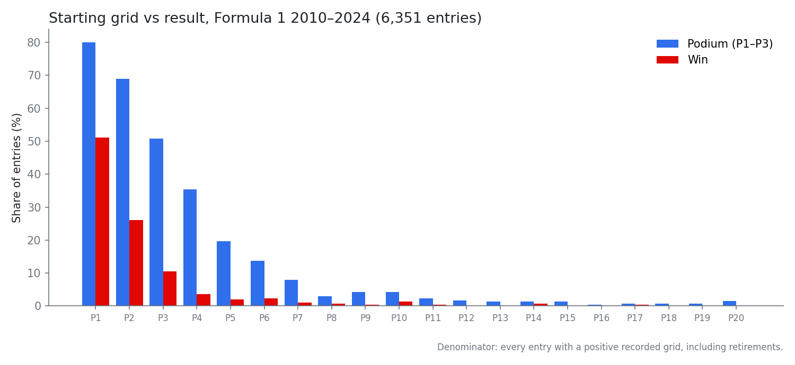
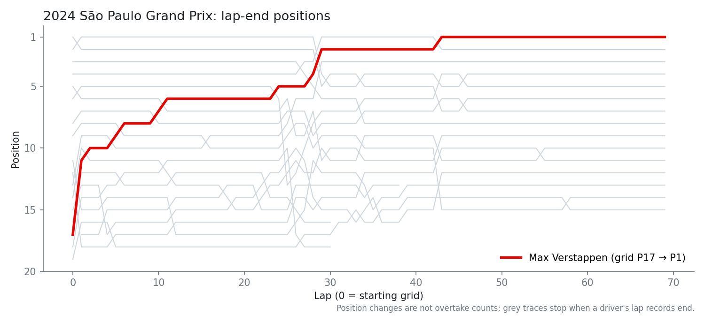

# From Grid to Glory 🏁

**When does starting position fail to predict a Formula 1 race?**

An interactive data story built on 75 years of Formula 1 results. It shows how strongly the starting grid is associated with the result, how rare comebacks from the back really are, and why the way you count a comeback changes the answer.

*SD6105 Data Visualisation (NTU), Group 19.*

[](https://youtu.be/CVoF_lE6ROA)

▶ **[Watch the 6-minute presentation on YouTube](https://youtu.be/CVoF_lE6ROA)** · 📊 **Live dashboard:** open [`docs/index.html`](docs/index.html) locally, or enable GitHub Pages (see [below](#run-the-dashboard)).

---

## Key findings (2010–2024, 305 Grands Prix)

| Question | Answer |
|---|---|
| How often does pole position win? | **156 of 305 races (51.2%)** |
| How often does a car starting P11 or lower reach the podium? | **38 of 3,307 entries (1.15%)** |
| Same question over the full history, 1950–2024 | 229 of 13,815 entries (1.66%) |
| Verstappen, 2024 São Paulo GP | P17 → P1: **+16 recorded places**. Among the 15 classified finishers he moved from 14th to 1st, so **+13 within the finish cohort** |
| Monteiro, 2005 United States GP (historical counterexample) | P17 → P3 is **+14 recorded**, but **0** within the cohort: only six cars started after the Michelin teams withdrew |





These are descriptive rates. They show a strong association between grid and result, not that the grid *determines* the result. A position gained is not the same thing as an overtake.

## What makes the analysis careful

- **Two ways to count a comeback.** *Recorded gain* is `grid − final classification`. *Finish-cohort gain* re-ranks only the drivers who were classified and finished, at both the start and the finish. Their difference shows how much of a "comeback" came from cars ahead dropping out.
- **Honest denominators.** Win and podium rates use *every* entry with a positive grid, retirements included. Dropping DNFs first would overstate the chances from the back.
- **Unclassified results are kept visible.** They form an `NC` row in the heatmap; they are not filled with `positionOrder`, which also orders unclassified cars.
- **A reviewed data layer.** Three duplicate grid values were corrected against official F1 starting-grid tables ([`config/grid_corrections.csv`](config/grid_corrections.csv)). The dashboard can switch between the original and reviewed values.
- **No carry-forward in replays.** In the lap replays, a retired driver's marker stops at their last recorded lap.

## Run the dashboard

The site is fully static and works offline. Plotly and the data bundle are included.

- **Locally:** double-click `docs/index.html`. It opens a recording navigator with three scenes: title → dashboard → conclusion. Press `1`–`3` or `←`/`→` to switch scenes and `H` to hide the controls. To open only the dashboard, use `docs/dashboard/index.html`.
- **GitHub Pages:** go to *Settings → Pages → Build from branch*, choose `main` and the `/docs` folder. The dashboard will then be live at `https://<your-username>.github.io/<repo-name>/`.

Dashboard views:
- **Overview:** heatmap of grid vs final classification (normalised per grid column), and a win/podium probability toggle.
- **Comeback Lab:** timeline of P11+ podiums, with recorded gain and finish-cohort gain compared against structurally similar cases.
- **Race Replay:** six comeback victories from 2000–2024, replayed lap by lap.

## Reproduce the data

```bash
pip install -r requirements.txt
python src/build_dashboard_data.py   # raw CSVs → docs/dashboard/assets/dashboard-data.js + outputs/*.csv
python src/make_readme_figures.py    # README figures
python src/validate.py               # checks every number quoted above and all local site links
```

The build takes a few seconds and reproduces the data bundle used in the recorded video.

## Repository layout

```text
├─ data/raw/            CC0 source CSVs used by the analysis (+ SCHEMA.md)
├─ config/              grid corrections and replay case list
├─ src/                 build, figure and validation scripts
├─ outputs/             verified_claims.csv, replay_coverage.csv
├─ docs/                static site (GitHub Pages root)
│  ├─ index.html        recording navigator
│  ├─ dashboard/        interactive dashboard (Plotly.js, offline)
│  ├─ cards/            title and conclusion cards
│  └─ img/              README figures
└─ report/              two-page summary report (PDF)
```

## Data

Data comes from the *Formula 1 World Championship (1950–2026)* dataset by A. Ranjan ([Kaggle](https://www.kaggle.com/), [GitHub](https://github.com/Arths17/f1-dataset)), released under **CC0**. The headline analysis stops at 2024. Only the seven tables the analysis uses are included here. Grid corrections cite the official Formula 1 starting-grid pages listed in the config file.

## Limitations

- Results are descriptive associations, not causal estimates.
- Finish-cohort gain removes one source of passive advancement (cars ahead not finishing). It does not control for strategy, safety cars, weather or penalties.
- Positive grid values can still encode unusual starts, such as pit-lane starts. The three corrections are not an exhaustive audit.
- Over 75 years, field sizes and rules changed, so the modern sample (2010–2024) is the default view.

## Team

Group 19, SD6105 Data Visualisation, Nanyang Technological University: **Jiang Yanxi** and **Ji Qiankun**. Contributions are described in the [summary report](report/G19_Summary_Report.pdf).

## License

Code: MIT (see [LICENSE](LICENSE)). Data: CC0, from the original dataset. Plotly.js is bundled under its own MIT license.
